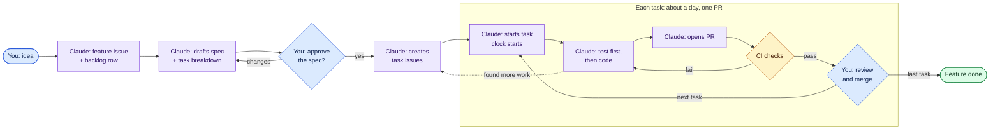

# job-search

A job-search assistant, built with [Claude Code](https://claude.com/claude-code) using a spec-driven AI coding workflow.

## Overview

_Coming in a later PR._

## How this project is built

You decide **what** gets built and approve the spec; Claude does the rest of the work. Each feature has a spec,
reviewed like code, that breaks the work into tasks of about a day. Each task is a GitHub issue delivered by one PR.
CI checks every PR before you merge it, and the timing of each task is recorded so progress can be measured.
Full rules: [ADR-0002](docs/adr/0002-spec-driven-workflow-with-github-issues.md); Claude's instructions: [CLAUDE.md](CLAUDE.md).

### What keeps it on track
- **The spec is approved before any code is written**, and it stays the source of truth for what's being built.
- **CI checks every PR:** the spec's task list matches GitHub, a feature is Done only once all its tasks are, and accepted decisions (ADRs) can't be edited, only superseded.
- **Personal data is blocked:** a pre-commit hook (once enabled) and CI reject resumes, documents and data files ([ADR-0003](docs/adr/0003-personal-data-outside-repo.md)).
- **Decisions are recorded** as ADRs, so the reasons behind the design aren't lost.

## Project setup

- Python 3.12+ and the [GitHub CLI](https://cli.github.com/) (`gh`).
- Enable the personal-data hook once per clone: `git config core.hooksPath scripts/hooks`
- Keep personal data outside the repo: set `JOB_SEARCH_DATA_DIR` (default `~/job-search-data`).
- Create the workflow labels once: `scripts/setup-labels.sh owner/repo`
- Run the tests: `python -m unittest discover -s tests -t . -v`

_More once the tech stack is chosen (ADR-0004)._

## Usage

_Coming once the tech stack is chosen._

## Project status

What's planned and in progress: [docs/BACKLOG.md](docs/BACKLOG.md). Task data (throughput, time per task): `python scripts/report.py`.

## Decisions

Architecture and process decisions are recorded as ADRs in [docs/adr/](docs/adr/).

## Personal data & security

This repository is public and never holds personal data ([ADR-0003](docs/adr/0003-personal-data-outside-repo.md)).
To report a security problem, see [SECURITY.md](SECURITY.md).

## License

Apache License 2.0. See [LICENSE](LICENSE).
